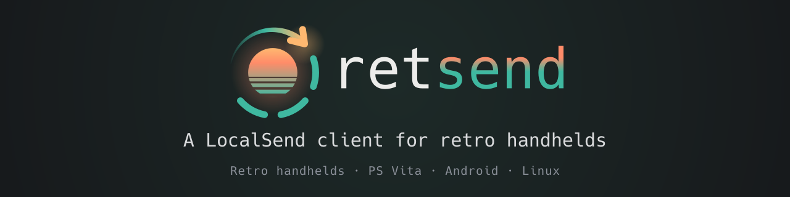
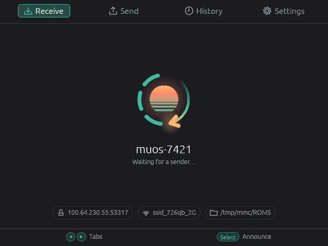
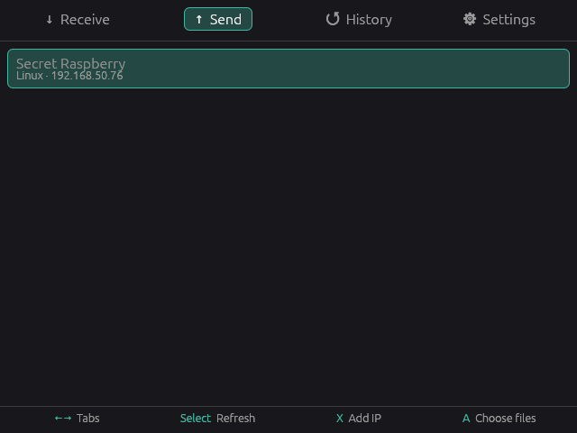
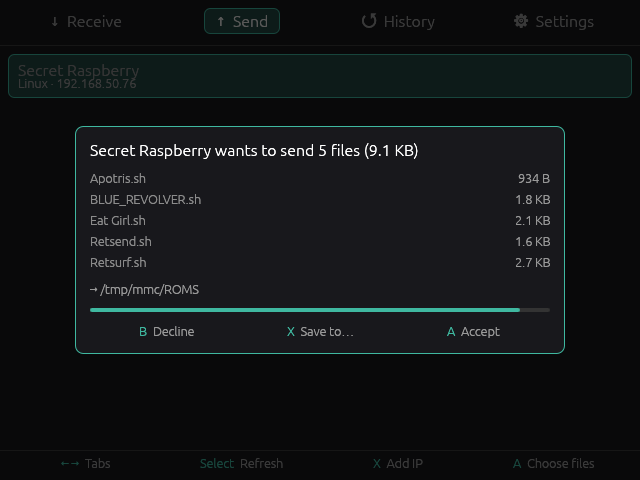
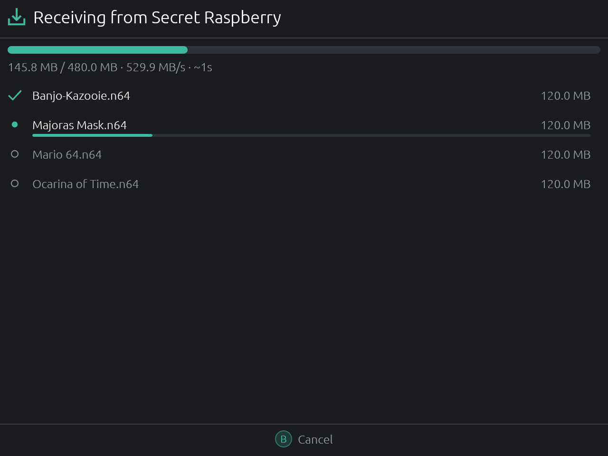
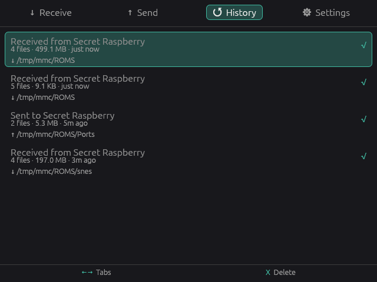
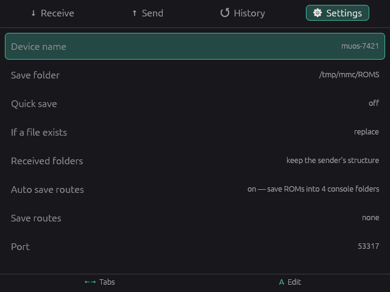

  

  
  
  <!-- The check workflow, not a platform build: it is the one a push and a pull request run, and it carries the tests and clippy. -->
  

  <a href="#install">Install</a> &middot;
  <a href="docs/CONFIGURATION.md">Docs</a> &middot;
  <a href="https://github.com/mxmgorin/retsend/issues">Issues</a>

retsend is a [LocalSend](https://localsend.org) client for retro handhelds, written in Rust with [SDL2](https://www.libsdl.org/) and [egui](https://github.com/emilk/egui). It sends and receives files with your phone or PC over Wi-Fi, without a cable, SSH or pulling the SD card, and works with the official LocalSend apps. Built for the gamepad; keyboard, touch and mouse work too.

**[Install](#install)** on handhelds through PortMaster, muOS, OnionOS, Allium, spruceOS, NextUI, NX Redux or Knulli, on the PS Vita, and on Android or Linux.

## Screenshots

| Receive | Send |
|:---:|:---:|
|  |  |

| Request | Transfer |
|:---:|:---:|
|  |  |

| History | Settings |
|:---:|:---:|
|  |  |

## Features

- **Discovery** 
  A live radar of nearby devices over LocalSend protocol v2.1, plus a device typed in by IP for networks that block multicast.

- **Receive** 
  Accept or decline with a countdown, speed and ETA, cancel from either side. X picks the folder for one transfer; quick save accepts everything.

- **Send** 
  A gamepad file browser with multi-select, whole folders and per-file progress. Pinned folders and files lead every listing.

- **Save routes** 
  Received ROMs land in the console folder they belong to, detected from the card, with per-extension overrides. See [Configuration](docs/CONFIGURATION.md#save-routes).

- **Folders** 
  A folder sent either way arrives as a folder.

- **History** 
  Every transfer is logged. A repeats a send, X deletes the row.

- **Encryption** 
  The protocol's HTTPS mode, on by default, compatible with the official apps' defaults.

- **Headless mode** 
  `retsend --receive` runs without a screen, for SSH and scripting. See [Command line](docs/CLI.md).

- **Runs wherever SDL2 does** 
  Draws through whatever video backend the firmware ships: a framebuffer, KMS/DRM, a vendor driver. X11, Wayland or a display manager are not required.

- **GPU optional** 
  OpenGL ES where there is one, SDL's own renderer where there is not, picked at start-up.

- **Small** 
  No async runtime, a minimal HTTP server, and the system's own SDL2 wherever it can drive the screen.

## Install

Download the package for your system. All builds are on
[Releases](https://github.com/mxmgorin/retsend/releases). Nightly builds from `main` use
the same file names under the rolling
[`nightly`](https://github.com/mxmgorin/retsend/releases/tag/nightly) tag.

| OS | Package | Where it goes |
| --- | --- | --- |
| [PortMaster](https://portmaster.games/supported-devices.html) | [`retsend-portmaster.zip`](https://github.com/mxmgorin/retsend/releases/latest/download/retsend-portmaster.zip) | ports folder, e.g. `/roms/ports/` |
| [muOS](https://muos.dev) | [`retsend-muos.muxapp`](https://github.com/mxmgorin/retsend/releases/latest/download/retsend-muos.muxapp) | `ARCHIVE/` on the SD card, then **Applications → Archive Manager** |
| [OnionOS](https://onionui.github.io/) | [`retsend-onionos.zip`](https://github.com/mxmgorin/retsend/releases/latest/download/retsend-onionos.zip) | root of the SD card, lands in `App/Retsend/` |
| [Allium](https://github.com/goweiwen/Allium) | [`retsend-allium.zip`](https://github.com/mxmgorin/retsend/releases/latest/download/retsend-allium.zip) | root of the SD card, lands in `Apps/Retsend.pak/` |
| [spruceOS](https://github.com/spruceUI/spruceOS) | [`retsend-spruceos-aarch64.zip`](https://github.com/mxmgorin/retsend/releases/latest/download/retsend-spruceos-aarch64.zip), [`retsend-spruceos-armhf.zip`](https://github.com/mxmgorin/retsend/releases/latest/download/retsend-spruceos-armhf.zip) (Miyoo Mini) | root of the SD card, lands in `App/Retsend/` |
| [NextUI](https://github.com/LoveRetro/NextUI), [NX Redux](https://github.com/mohammadsyuhada/nx-redux) | [`retsend-nextui.zip`](https://github.com/mxmgorin/retsend/releases/latest/download/retsend-nextui.zip) | root of the SD card, lands in `Tools/` |
| [Knulli](https://knulli.org) | [`retsend-knulli.zip`](https://github.com/mxmgorin/retsend/releases/latest/download/retsend-knulli.zip) | `roms/` in the share (`/userdata/roms/`), lands in `tools/` |
| PS Vita ([HENkaku](https://henkaku.xyz/)) | [`retsend-vita.vpk`](https://github.com/mxmgorin/retsend/releases/latest/download/retsend-vita.vpk) | install with VitaShell |
| Android | [`retsend-android-arm64.apk`](https://github.com/mxmgorin/retsend/releases/latest/download/retsend-android-arm64.apk), [`retsend-android-armv7.apk`](https://github.com/mxmgorin/retsend/releases/latest/download/retsend-android-armv7.apk) (32-bit) | sideload it |
| Linux | [`retsend-linux-x86_64.zip`](https://github.com/mxmgorin/retsend/releases/latest/download/retsend-linux-x86_64.zip), [`retsend-linux-aarch64.zip`](https://github.com/mxmgorin/retsend/releases/latest/download/retsend-linux-aarch64.zip), [`retsend-linux-armhf.zip`](https://github.com/mxmgorin/retsend/releases/latest/download/retsend-linux-armhf.zip) | unpack and run |

The app shows up in the Apps (or Applications) menu. How to quit on each system is
in [Controls](docs/CONTROLS.md#quitting). The Miyoo Mini build needs the Mini Plus
or Mini Flip: the original Mini has no Wi-Fi.

On Android, grant **All files access** and received files land in `Download/`;
otherwise the app keeps to its own folder. See [android/README.md](android/README.md).

## Building

`cargo run` with SDL2 installed. See **[Building from source](docs/BUILDING.md)**
for handhelds, Android and the PS Vita.

## Configuration

`config.toml` is in the data dir (`SDL_GetPrefPath`, e.g.
`~/.local/share/mxmgorin/retsend/` on Linux) and is written with the defaults on
first run. See **[Configuration](docs/CONFIGURATION.md)** for the options, save
routes and folders, **[Controls](docs/CONTROLS.md)** for buttons and touch, and
**[Command line](docs/CLI.md)** for arguments and environment variables.

## How to help

If you find the project useful, here is how you can help:

- **Tell other people about it.** Sharing the project helps it reach more users.
- **Report bugs and request features** in [Issues](https://github.com/mxmgorin/retsend/issues). Feedback is welcome.
- **Star the repo.** It helps the project get noticed and keeps me motivated.
- **[Buy me a coffee](https://ko-fi.com/mxmgorin)** on Ko-fi.

## Credits

retsend is built on:

- the [LocalSend](https://localsend.org) protocol, so it works with the official apps
- [SDL2](https://libsdl.org) through [rust-sdl2](https://github.com/Rust-SDL2/rust-sdl2)
  for the window and input
- [egui](https://github.com/emilk/egui) for the UI
- [rustls](https://github.com/rustls/rustls) over [ring](https://github.com/briansmith/ring)
  for TLS, [rcgen](https://github.com/rustls/rcgen) for certificates and
  [ureq](https://github.com/algesten/ureq) as the HTTP client
- [Steward Fu's SDL2](https://github.com/steward-fu/sdl2) with the Miyoo Mini display driver
- [VitaSDK](https://vitasdk.org) and [vita-rust](https://github.com/vita-rust) for the PS Vita build
- [PortMaster](https://portmaster.games) for running on Linux handhelds
